# 🚨 Awesome Real-Time Model Drift Alerting Tools ⚡



<a href="https://github.com/ishandutta2007/Awesome-Awesome-Awesome"></a><a href="https://discord.gg/jc4xtF58Ve"></a> [](https://github.com/ishandutta2007/Awesome-Awesome-Awesome) [](https://opensource.org/licenses/MIT) [](http://makeapullrequest.com) <a href="https://github.com/ishandutta2007"></a>

> ⚡ **A curated list of Enterprise SaaS Platforms, Open-Source Libraries, and MLOps Frameworks for Real-Time Model Drift Alerting, Data Drift Detection, Concept Drift Tracking, Feature Distribution Shift Monitoring, and Automated Incident Response.**

---

## 📑 Table of Contents
- [🌐 Sector Overview & Market Dynamics](#-sector-overview--market-dynamics)
- [🏢 SaaS & Commercial Platforms](#-saas--commercial-platforms)
- [💻 Open-Source GitHub Projects](#-open-source-github-projects)
- [🔬 Core Drift Detection Metrics Reference](#-core-drift-detection-metrics-reference)
- [🏗️ Reference Real-Time Alerting Architecture](#%EF%B8%8F-reference-real-time-alerting-architecture)
- [🤝 How to Contribute](#-how-to-contribute)
- [💖 Support & Sponsorship](#-support--sponsorship)
- [📈 Star History](#-star-history)
- [⚠️ Disclaimer](#%EF%B8%8F-disclaimer)

---

## 🌐 Sector Overview & Market Dynamics

> 💡 **Market Size & Fragmentation:**  
> The global **AI & ML Observability and Drift Detection Market** was valued at approximately **$2.1 Billion to $2.7 Billion in 2025** and is projected to expand at a rapid Compound Annual Growth Rate (CAGR) of **24.5% to 32.8%**, surpassing **$9.5 Billion by 2032**, driven by enterprise LLM deployments, multi-agent workflows, and regulatory AI governance mandates.  
> The sector is undergoing rapid **market consolidation**: while initially highly fragmented with dozens of specialized point-solution startups, the industry is transitioning into a moderately concentrated ecosystem where enterprise observability giants (such as Datadog and Coralogix) and tech conglomerates (such as Apple) actively acquire niche drift and telemetry pioneers, while established AI platforms (Arize, Monte Carlo, Fiddler) expand into end-to-end full-lifecycle observability suites.

---

## 🏢 SaaS & Commercial Platforms

Below is a detailed comparative breakdown of leading commercial SaaS platforms for real-time model monitoring and drift alerting, sorted by company valuation / scale (descending).

| 🏢 Platform | 💰 Valuation / Scale (Descending) | 🏷️ Starting Price | 🆓 Free Plan / Trial Limit | 🔑 Key Capabilities |
| :--- | :--- | :--- | :--- | :--- |
| **[Datadog LLM Observability](https://www.datadoghq.com/)** | **~$42.0 Billion (Market Cap)** / ~$2.68B Revenue | **$160 / month** (LLM Observability Pro, 100k spans) / **$31 / host / month** (APM) | ⏱️ **14-Day Free Trial** (Full access) & permanent free tier for 40,000 LLM spans/mo & 5 hosts | Enterprise APM & LLM observability, automated latency regression alerts, hallucination scoring, token consumption metrics, and incident routing. |
| **[Monte Carlo](https://montecarlo.ai/)** | **$1.60 Billion (Valuation)** / ~$75M–$80M ARR | **$50,000 / year** (~$4,166 / month baseline AWS Marketplace contract) | ⏱️ **14-Day Sandbox PoC** (End-to-end data pipeline evaluation upon guided demo request) | ML-powered automated data anomaly detection, field-level drift tracking, cross-warehouse lineage, incident triage, and Operations Agent for alert gaps. |
| **[Arize AI](https://arize.com/)** | **$500 Million+ (Valuation)** / $131M Total Funding | **$50 / month** (Arize AX Pro, 50,000 spans/mo, 10 GB storage) | 🆓 **Free Forever** (25,000 spans/month, 1 GB ingestion/mo, 15-day retention, 10 issue detection signals/mo) | Auto-advancing baseline drift monitors, embedding drift analysis, feature store monitoring, train-serve skew detection, and multi-channel webhook alerting. |
| **[Arthur AI](https://arthur.ai/)** | **$300 Million (Valuation)** / $65.7M Total Funding | **$60 / month** (Premium tier, up to 100 use cases, 30-day retention) | 🆓 **Free Forever** (Up to 4 monitored use cases, unlimited user seats, 7-day data retention window) | Model and agent observability, data and concept drift detection, root cause analysis, SHAP-based feature importance, and enterprise AI compliance governance. |
| **[Fiddler AI](https://fiddler.ai/)** | **$250 Million (Est. Valuation)** / $62M+ Total Funding | **$0.002 / trace** (Developer tier, or ~$50 / month platform minimum) | 🆓 **Free Forever** (Up to 10,000 traces/month, real-time guardrails, pre-built evaluations) + 14-day enterprise trial | Real-time data & prediction drift detection using Jensen-Shannon Distance (JSD) & PSI, feature impact scoring, root cause analysis, and low-latency guardrails. |
| **[WhyLabs](https://whylabs.ai/)** *(Acquired by Apple)* | **$80 Million (Est. Acquisition Valuation)** / $14M Total Funding | **$125 / month** (Historical Expert SaaS tier; core control center now fully open-sourced via Apache 2.0) | 🆓 **Free Forever** (Starter tier: up to 200 features/columns per project and 10M predictions/mo; now unlimited open source via whylogs) | Statistical profiling, zero-data-movement drift alerting, mergeable profile sketches, integrated constraints, and CI/CD data quality gates. |
| **[Aporia](https://aporia.com/)** *(Acquired by Coralogix)* | **$50 Million (Acquisition Valuation)** / Coralogix Valued at ~$900M | **$15 / month** (Coralogix AI Observability) / **$50 / month** (Aporia Starter) | ⏱️ **14-Day Free Trial** (Full access, up to 3 production models, data drift & prediction drift alerting) | Monitoring-as-code via Python SDK, statistical drift detectors, data integrity checks, real-time guardrails, and automated anomaly alerting. |
| **[Censius](https://censius.ai/)** | **$20 Million (Est. Valuation)** / ~$1.7M ARR | **$300 / month** (Custom starter plan for up to 3 production models, billed annually) | ⏱️ **14-Day Free Trial** (Full access to data quality, model drift, and explainability dashboards upon demo request) | Continuous data drift and concept drift monitoring, SHAP-driven root cause violation analysis, performance vs. drift correlation, and fairness audits. |
| **[Superwise](https://superwise.ai/)** | **$18 Million (Est. Valuation)** / $5M Total Funding | **$10 / month** (Solo tier) / **$50 / month** (Pro tier) | 🆓 **Free Forever** (Starter edition: 1 agent/model, 1 dataset, runtime guardrails, real-time observability; no credit card required) + 30-day trial on paid tiers | Dynamic drift threshold calculation (moving averages), Jensen-Shannon Divergence and Wasserstein Distance detectors, multi-channel webhook alerting. |
| **[Evidently Cloud](https://evidentlyai.com/)** | **$15 Million (Est. Valuation)** / Seed Backed (Atomico & YC) | **$250 / month** (Expert / Managed platform tier with 90% startup discount available) | 🆓 **Free Forever** (Core self-hosted dashboard & library is 100% free under Apache 2.0; 14-day trial for managed platform) | 100+ drift and data quality metrics, self-hostable monitoring dashboard, test suites with automated reference thresholds, and enterprise security integrations. |

---

## 💻 Open-Source GitHub Projects

Explore top self-hosted and open-source software solutions for real-time model monitoring, statistical drift detection, data logging, and alert routing. Repositories are sorted by GitHub Star Count (descending).

| 📦 Repository & Description | ⭐ Stars Badge | 🛠️ Tech Stack & Drift Detection Highlights |
| :--- | :--- | :--- |
| **[Langfuse](https://github.com/langfuse/langfuse)** <br> Open-source LLM engineering platform offering end-to-end tracing, evaluation, cost tracking, latency monitoring, and drift alerting for LLMs and agent workflows. | [](https://github.com/langfuse/langfuse/stargazers) | TypeScript, Python, PostgreSQL • Real-Time Tracing, Cost/Latency Drift & Eval Alerts |
| **[Great Expectations](https://github.com/great-expectations/great_expectations)** <br> The leading open-source data quality and pipeline validation standard. Automates statistical profiling, data drift testing, and schema validation across batch and streaming pipelines. | [](https://github.com/great-expectations/great_expectations/stargazers) | Python, SQL, Spark • Automated Data Profiling, Test Suites & CI/CD Pipeline Gates |
| **[Arize Phoenix](https://github.com/Arize-ai/phoenix)** <br> Open-source AI observability and evaluation library built on OpenTelemetry. Detects embedding drift, prompt drift, semantic regression, and latency bottlenecks with native visualization. | [](https://github.com/Arize-ai/phoenix/stargazers) | Python, OpenTelemetry, React • Embedding Drift, UMAP Projections & Agent Tracing |
| **[Cleanlab](https://github.com/cleanlab/cleanlab)** <br> Standard open-source library for data-centric AI. Automatically detects dataset shift, out-of-distribution drift, label errors, and feature corruption across tabular, image, audio, and text data. | [](https://github.com/cleanlab/cleanlab/stargazers) | Python, PyTorch, Scikit-learn • Out-of-Distribution Drift, Dataset Shift & Data Curation |
| **[Evidently](https://github.com/evidentlyai/evidently)** <br> The most popular open-source ML monitoring framework. Provides 100+ statistical metrics for data quality, covariate drift, concept drift, and model performance with a self-hostable monitoring dashboard. | [](https://github.com/evidentlyai/evidently/stargazers) | Python, FastAPI, TypeScript • 100+ Drift Metrics, Self-Hosted Dashboard & Test Suites |
| **[River](https://github.com/online-ml/river)** <br> Dynamic open-source Python library for online machine learning and streaming data. Implements streaming drift detectors (ADWIN, DDM, EDDM, Page-Hinkley) that trigger instantaneous alerts on continuous streams. | [](https://github.com/online-ml/river/stargazers) | Python, Cython • Online ML, Real-Time Streaming Drift Detectors (ADWIN, DDM, EDDM) |
| **[Deepchecks](https://github.com/deepchecks/deepchecks)** <br> Comprehensive open-source test suite for continuous validation of machine learning models and data. Detects feature drift, label drift, data leakage, and train-test distribution discrepancies. | [](https://github.com/deepchecks/deepchecks/stargazers) | Python • Continuous Validation, Feature & Label Drift Tests, Integrity Checks |
| **[TruLens](https://github.com/truera/trulens)** <br> Open-source evaluation and tracking framework for LLM applications and AI agents. Measures semantic drift, hallucination frequency, answer relevance, and groundedness in real-time inference chains. | [](https://github.com/truera/trulens/stargazers) | Python, Streamlit • Feedback Functions, Semantic Drift Tracking & LLM Triad Evals |
| **[whylogs](https://github.com/whylabs/whylogs)** <br> The open standard for data logging and statistical profiling. Generates lightweight, mergeable statistical sketches of production data streams without transmitting raw records, enabling zero-egress drift monitoring. | [](https://github.com/whylabs/whylogs/stargazers) | Python, Java, Apache Spark • Mergeable Statistical Sketches, Zero-Egress Profiling |
| **[Alibi Detect](https://github.com/SeldonIO/alibi-detect)** <br> Open-source Python library focused on outlier, adversarial, and drift detection. Implements state-of-the-art two-sample tests including Kolmogorov-Smirnov, Maximum Mean Discrepancy (MMD), and Learned Kernels. | [](https://github.com/SeldonIO/alibi-detect/stargazers) | Python, TensorFlow, PyTorch • KS Test, MMD, Cramér-von Mises & Adversarial Detectors |
| **[NannyML](https://github.com/NannyML/nannyml)** <br> Open-source library for post-deployment data science. Specializes in estimating production model performance without ground-truth labels using Confidence-Based Performance Estimation (CBPE) and multivariate drift (PCA). | [](https://github.com/NannyML/nannyml/stargazers) | Python, Plotly • Unsupervised Performance Estimation (CBPE), Multivariate Drift & Alerts |
| **[Frouros](https://github.com/IFCA-Advanced-Computing/frouros)** <br> Open-source Python library for concept drift and data drift detection. Features both streaming (CUSUM, Page-Hinkley) and batch algorithms (Kolmogorov-Smirnov, PSI, Wasserstein Distance). | [](https://github.com/IFCA-Advanced-Computing/frouros/stargazers) | Python, Scipy • Streaming & Batch Drift Detection, Distance & Statistical Tests |
| **[Eurybia](https://github.com/MAIF/eurybia)** <br> Open-source library to monitor model drift over time and secure model deployment with data validation, model governance, and drift visualization dashboards. | [](https://github.com/MAIF/eurybia/stargazers) | Python • Model Decay Tracking, Covariate Drift Analysis & Validation Dashboards |
| **[Menelaus](https://github.com/mitre/menelaus)** <br> MITRE-developed open-source library for streaming and batch concept and data drift detection, supporting both supervised and unsupervised streaming anomaly workflows. | [](https://github.com/mitre/menelaus/stargazers) | Python, NumPy • Streaming Anomaly Detectors, Adaptive Windowing & Batch Drift Tests |
| **[DriftWatch](https://github.com/Kernel-ML/driftwatch)** <br> Lightweight self-hosted model monitoring microservice for drift detection, latency tracking, and automated alerting via Slack, Prometheus, and generic HTTP webhooks. | [](https://github.com/Kernel-ML/driftwatch/stargazers) | Python, FastAPI • PSI & KS Drift Tests, Latency SLA Percentiles & Webhook Alerts |
| **[LLM Drift Sentinel](https://github.com/prabhakaran-jm/llm-drift-sentinel)** <br> Enterprise LLM observability platform on GCP Vertex AI. Features real-time drift detection and abuse monitoring with Datadog event and incident dispatch. | [](https://github.com/prabhakaran-jm/llm-drift-sentinel/stargazers) | Python, GCP Vertex AI, Datadog • LLM Semantic Shift, Toxic Prompt & PII Leak Alerting |
| **[LLM Health Observability](https://github.com/ByteWise-Cookie/llm-observability)** <br> Real-time semantic risk monitoring for production Gemini deployments. Tracks hallucination risk, hedging frequency, and verbosity ratios with Datadog telemetry streams. | [](https://github.com/ByteWise-Cookie/llm-observability/stargazers) | Python, Google Gemini, Datadog • Semantic Drift, Hallucination Risk Scoring & Streaming |

---

## 🔬 Core Drift Detection Metrics Reference

When selecting or configuring automated drift alerting thresholds, understanding the mathematical trade-offs between statistical tests is crucial:

| 📊 Metric / Test | 🎯 Data Type | 💡 Recommended Use Case | ⚠️ Operational Caveat |
| :--- | :--- | :--- | :--- |
| **Population Stability Index (PSI)** | Categorical & Binned Numerical | Credit scoring, tabular features, risk modeling | Sensitive to bin count; empty bins require epsilon smoothing to avoid $\infty$. |
| **Kolmogorov-Smirnov (KS) Test** | Continuous Numerical | Single-feature distribution shift against baseline | High statistical power on large sample sizes can trigger false positives on minor shifts. |
| **Wasserstein Distance (EMD)** | Continuous Numerical | Physical distances, spatial distributions, pricing | Computationally heavier than KS-test; represents actual magnitude of shift. |
| **Jensen-Shannon Divergence (JSD)** | Discrete Probability Distributions | Softmax prediction outputs, multi-class probabilities | Symmetric and bounded between $[0, 1]$; excellent for classification output drift. |
| **Maximum Mean Discrepancy (MMD)** | High-Dimensional / Embeddings | Text embeddings, image latent spaces, LLM representations | Kernel-based two-sample test; requires calibrated bandwidth heuristic for high accuracy. |
| **ADWIN (Adaptive Windowing)** | Streaming Data Streams | Real-time sensor feeds, financial clickstreams, rapid concept drift | Adjusts sliding window size automatically; optimal for streaming without fixed batch windows. |

---

## 🏗️ Reference Real-Time Alerting Architecture

A production-grade real-time model drift alerting pipeline typically follows this event-driven architecture:

```
[Production Inference API]
         │
         ▼ (Async Telemetry / Kafka / EventBridge)
[Statistical Profiler (e.g., whylogs / River)]
         │
         ▼ (Rolling Window vs. Baseline Snapshot)
[Drift Detection Engine (e.g., Evidently / Alibi Detect)]
         │
    ┌────┴───────────────────────────┐
    ▼ (Threshold Exceeded)           ▼ (Normal Distribution)
[Alert Manager / Router]         [Metrics Dashboard (Grafana / Datadog)]
    ├──> 📢 Slack / Discord
    ├──> 📟 PagerDuty / OpsGenie
    └──> 🔁 Automated Retraining Webhook (Airflow / Kubeflow)
```

---

## 🤝 How to Contribute

Contributions are welcome! Please follow these simple steps:

1. 🍴 **Fork the repository**
2. 📝 **Add or update entries** in `README.md` (keep formatting consistent with existing tables)
3. 📌 **Include essential details**: Name, website/repo link, verified pricing or live star badges, and concise capabilities.
4. 📬 **Submit a Pull Request** with a brief summary of additions.

Star the repo if you find it useful! ⭐

---

## 💖 Support & Sponsorship

Thank you for exploring and using this repository! If you find this curated list valuable for your MLOps pipelines, research, or enterprise monitoring infrastructure, please consider supporting the project:

- ⭐ **Star this repository** on GitHub to show your appreciation and boost discoverability.
- 🔀 **Fork & Share** it with your engineering team, data scientists, and MLOps peers.
- ☕ **Buy me a coffee / Sponsor**: You can sponsor ongoing maintenance and open-source updates via the [GitHub Sponsor Dashboard](https://github.com/sponsors/ishandutta2007).

---

##  Star History

[](https://star-history.dera.page/#ishandutta2007/Awesome-Real-Time-Model-Drift-Alerting-Tools&type=date&legend=top-left)

---

## ⚠️ Disclaimer

- This is a **community-curated** list compiled for educational, research, and technical evaluation purposes only.
- Model drift alerting thresholds must be calibrated to your specific data distributions, production traffic volumes, and business impact. **No single drift metric is universally optimal** — empirical testing and baseline tuning are required before attaching automated retraining webhooks.
- Self-hosted open-source solutions provide maximum data sovereignty but require robust telemetry infrastructure, while commercial SaaS platforms offload operational overhead at the cost of consumption-based licensing.

---

**Made with ❤️ for ML Engineers, MLOps Practitioners, Data Scientists, and AI Platform Architects.**
